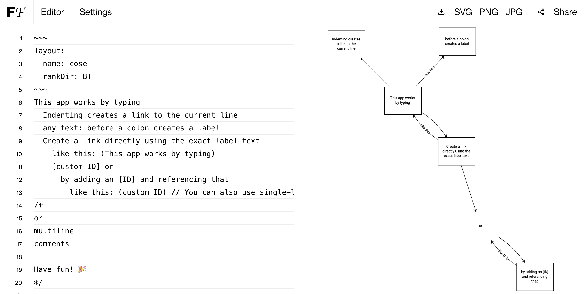
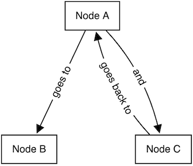

# Flowchart Fun

[Flowchart Fun](https://flowchart.fun/) is a webapp for quickly generating flowcharts from text. With a fast and intuitive workflow, you can visualize your ideas and plans in minutes.



## Features 

Flowchart Fun is actively working on implementing new and innovative features! Some of are features include:
  -Editing with AI
  -Importing Data
  -Variety of Templates
  -Importing Data
  -Different Themes 
  -10 Layout Designs
  -Different Background Colors
  -Different Node Shapes and Colors
  -Log In to Save Your Charts! Creating An Account is Quick and Easy! 
  -Try Out FlowChart Fun Pro For a Variety of Premium Features! 
  
## 📝 Example

For an example of how Flowchart Fun works, take the following input:

```
Node A
  goes to: Node B
  and: Node C
    goes back to: (Node A)
```

You can generate this flowchart with just a few clicks:



## 🛠️ Development

Before making a contribution to Flowchart Fun, you should know a little bit about the technologies we're using.
After that, you should be ready to help out! 

Flowchart Fun is built with [React](https://reactjs.org/) and [cytoscape.js](https://github.com/cytoscape/cytoscape.js).

-**React:** A JavaScript library for building dynamic user interfaces based on components.
  -Want to familiarize yourself with React? Read the official React documentation (https://reactjs.org/docs/getting-started.html)
   to learn more. 
-**Cytoscape:** CytoScape is a Graph theory (network) library for visualisation and analysis. 
  -Learn more about Cytoscape on its offical website (https://js.cytoscape.org/#introduction/factsheet). 

### 💡 Prerequisites

If you plan on developing the premium features, you will need accounts on [Vercel](https://vercel.com/docs/concepts/functions/introduction), [Supabase](https://supabase.io/), [Stripe](https://stripe.com/) and [Sendgrid](https://sendgrid.com/).

### 🚀 Getting Started

1. Clone the repository
1. Copy `.env.example` to `.env` and add env variables
1. `pnpm install` and `vercel dev`

Note: `shared` and `formulaic` must be built before the app will run — run `pnpm -F shared build && pnpm -F formulaic build` after installing.

#### 🔒 To run with login features:

`vercel dev`

Note: You will need to create a [Vercel account](https://vercel.com/signup) and [install the CLI](https://vercel.com/download) to run the app locally. To deploy the app, you will need a Pro Vercel account because it uses more than 12 serverless functions.

#### ⚙️ To run without login features:

`pnpm dev`

### 🌐 Translations

Flowchart Fun is available in a variety of languages: 
-Deutsch
-English
-Español
-Fançais
-हिन्दी
-한국어
-Português
-中文

We welcome anyone interested in helping us add translations to Flowchart Fun. Translations can be added to the .po files located in /app/src/locales/[language]/messages.po. After adding translations, please run `pnpm -F app compile`. We would appreciate your help in making Flowchart Fun accessible in even more languages!

#### 💬 Interested in Adding a Language?

Let us know about your plans in the [Discord](https://discord.com/invite/wPASTQHQBf), and we'd be glad to lend a helping hand.

### 🧪 Tests

To ensure quality and accuracy, Flowchart Fun employs [Jest](https://jestjs.io/) for unit testing and [Playwright](https://github.com/microsoft/playwright) for e2e testing.

#### Unit Tests

`pnpm -F app test`

#### E2E Tests

`pnpm -F app e2e`

### 🔍 Analyzing the Bundle

`pnpm -F app build && pnpm -F app analyze`

## 🤝 Contributing

If you're interested in contributing, we'd love to have your help with the underlying syntax parser - [Graph Selector](https://github.com/tone-row/graph-selector). Our community welcomes all contributions, big or small!

To get started, please fork the dev branch and start developing and testing your feature. If you have any questions, don't hesitate to join the discussion on [Discord](https://discord.com/invite/wPASTQHQBf). We're always happy to help and answer any questions you may have.
